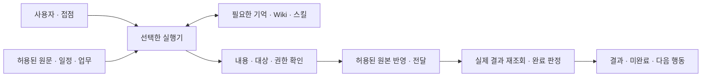

# 대화형 설계·운영 점검

사용자의 실제 사례에서 목적·가정·반례·선택의 영향을 질문하고, 답변을 시스템 구조와 검증 기준으로 바꾼다. 여기서 ‘소크라테스식’은 이러한 **적응형 문답 방식**을 뜻한다. 정해진 질문을 끝까지 읽거나 사용자가 기술 설계를 직접 작성하게 하는 방식으로 운영하지 않는다.

처음에는 **질문 → 답변 해석 → 구조 갱신 → 남은 결정 → 구축**, 운영 중에는 **기존 설계 → 실제 증거 → 차이를 좁히는 질문 → 유지/보완 → 재검증**으로 진행한다. 제품 목록보다 원하는 결과와 필요한 역할을 먼저 정한다. 지식관리·라이프 관리·기업 업무는 복수/전체 선택을 유지한다.

## 1. 시작 모드와 수행 범위

기존 요청으로 명확하면 다시 묻지 않는다. 모드와 실제 변경 권한을 구분하며 진행 위치는 [셋업 진행 기록](<../30_양식/셋업 진행 기록.md>)에 남긴다.

| 상황 | 먼저 확인할 것 | 다음 행동 |
| --- | --- | --- |
| 처음 설계 | 목적·선택한 전체 흐름·기존 환경·제약 | 질문으로 전체 구조 초안을 만들고 현재 단계의 필수 결정을 확정 |
| 구축 재개 | 구조 버전·기존 답변·마지막 성공·현재 대상 상태 | 바뀐 사실·미정만 확인하고 미완료 단계부터 진행 |
| 운영 점검 | 합의된 구조·규칙·설정·최근 결과·사용자 체감 | 읽기 전용 비교로 시작하고 설계/설정/실행 차이를 구분 |

“설계만”이면 구조와 실행 가능한 계획까지, “구축해줘”면 필요한 결정 후 허용된 구축·검증까지 수행한다. “점검해줘”만 요청한 경우 실제 운영 설정을 변경하는 단계로 자동 전환하지 않는다. “점검하고 고쳐줘”면 구체적인 원인·변경·복귀 수단을 마련한 후 기존 권한 안에서 보완한다. 새로운 결제·자료 반출·권한 확대 등 범위 밖 행동만 필요한 확인을 추가한다.

이 대화 절차를 문서에 넣는 것과 지금 사용자의 실제 시스템에 대한 인터뷰·구축을 시작하는 것은 다르다. 문서 작성 중의 예시 답변을 실제 사용자 결정으로 기록하지 않는다.

## 2. 한 번의 문답이 진행되는 방식

1. **먼저 읽는다.** 결정 기록·현재 구성·확인 가능한 상태에서 답을 찾는다. 버전·설치 여부 등 조사 가능한 사실을 사용자에게 다시 입력시키지 않는다. 비밀값이나 필요 없는 개인 자료는 수집하지 않는다.
2. **가장 중요한 질문 하나를 고른다.** 현재 단계의 진행을 막거나 구조를 크게 바꾸는 의도·완료 기준·제약부터 묻는다. 직접 연관된 질문만 최대 2–3개로 묶고, 전체 질문 목록을 한꺼번에 제시하지 않는다.
3. **답변을 짧게 해석한다.** “이 답변은 ○○ 역할이 필요하고 △△는 자동화하지 않는다는 뜻으로 반영하겠습니다”처럼 구조에 미치는 영향을 알린다. 사용자가 말한 내용과 에이전트의 추가 가정을 구분한다.
4. **필요한 경우에만 더 묻는다.** 모호한 말에는 실제 예시, 숨은 가정에는 근거, 충돌에는 반례·우선순위를 묻는다. 명확한 답변마다 “맞나요?”를 붙이거나 반복해서 이유를 캐묻지 않는다.
5. **구조·규칙·시험을 함께 갱신한다.** 답변을 관련 F/D, 구성 요소·연결, 완료 기준·검증 사례에 연결한다. 관찰 사실·사용자 확정·위임된 선택·가정·미정을 구분한다.
6. **다음 핵심 질문 또는 실행으로 이동한다.** 현재까지 정한 것·남은 중요한 쟁점·다음 행동을 짧게 보여 준다. 충분한 답을 얻은 항목은 닫는다. 새 정보가 생겼을 때만 다시 연다.

“모르겠다”는 답에는 사용자의 사례를 바탕으로 추천안과 대안, 비용·편의·통제의 차이를 쉽게 설명한다. 되돌릴 수 있는 기술 선택을 위임받으면 근거·변경 방법을 남기고 진행한다. 침묵이나 기본 선택을 과금·녹음·외부 전송 허용으로 간주하지 않는다. 대화를 멈추거나 다음에 이어가려 하면 답변과 다음 질문의 위치를 저장한다.

### 질문을 고르는 기준과 예시

| 질문 목적 | 초기 설계 예시 | 운영 점검 예시 |
| --- | --- | --- |
| 목적·사례 | “최근에 놓친 일 한 가지를 이 시스템이 어떻게 도와줬으면 하나요?” | “최근 결과 중 기대와 가장 달랐던 한 건은 무엇인가요?” |
| 의미·완료 | “‘정리됐다’고 느끼려면 어디에서 어떤 결과가 보여야 하나요?” | “완료로 표시된 이 일은 실제로 어떤 결과가 남았나요?” |
| 가정·근거 | “집 서버가 꺼진 동안에도 새 처리가 필요한가요, 다음 접속 때 처리해도 되나요?” | “즉시 알림이 필요하다고 정했는데, 현재도 같은 이유가 유효한가요?” |
| 반례·경계 | “회의에서 검토하자는 제안만 나와도 할 일을 등록할까요?” | “알림은 왔지만 작업은 하지 않은 사례에서도 완료로 바뀌었나요?” |
| 대안·상충 | “무료 운영과 서버가 꺼져도 즉시 처리 중 어느 조건을 먼저 지켜야 하나요?” | “요약 누락을 줄이면서 알림 횟수도 줄이려면 어떤 결과를 묶어 받아도 되나요?” |
| 이해·검증 | “휴대폰에서 요청한 일이 끝났는지 어디에서 확인하게 될까요?” | “지금 중지하거나 잘못된 기억을 고치려면 어떤 경로를 사용하나요?” |

표의 질문은 후보이며 필수 설문이 아니다. 기술 용어를 모르면 에이전트가 구조를 설명하고 사용자는 원하는 행동·허용 범위를 판단할 수 있게 한다.

## 3. 초기 설계 — 전체 구조를 먼저 보이게 한다

[초기 셋업 흐름](<초기 셋업 흐름.md>) 0–1단계의 파일·환경 확인 뒤 이 절을 적용한다. [업무 시나리오·셋업 질문](<업무 시나리오·셋업 질문.md>)은 필요한 기능의 질문 자료로 사용하고, 대화 중에 필요한 절만 읽는다.

대화가 진행될 때 **전체 선택 범위와 구성 요소의 관계**를 [결정 기록](<../30_양식/구축 결정·규칙 기록.md>)의 구조 초안에 갱신한다. 상세 설정을 전부 확정하기 전에도 아래 역할이 필요한지와 연결 방향은 보여 줄 수 있다.

| 구조에서 보여 줄 것 | 결정할 내용 | 기존 기록 연결 |
| --- | --- | --- |
| 목적·업무·사용자 | 선택한 전체 흐름, 결과·제외 범위·담당 | F01·D01·D08 |
| 접점·자료 입력 | 요청 창구, 캘린더/메일/대화/문서 등의 필요 연결 | F03·D02 |
| 실행 환경 | 담당 호스트·실행기·모델, 기기별 역할·ON/OFF 동작 | F02·D03 |
| 저장·기억·지식·절차 | 각각의 기준 원본·ID·소유자, Wiki/기억/스킬의 역할 | F04·F05·D05·D09 |
| 권한·자동화 경계 | 개인/기업 구분, 허용 행동·외부 처리·검토·중지 조건 | F07·F08·D04 |
| 결과·품질·복구 | 실제 완료 근거, 알림과 실패, 예산·백업·교정·복귀 | F06·F09–F12·D06·D07 |
| 단계별 구축 | 기존 기능 재사용·부족한 역할·제품 선택, 의존 관계·후속 순서 | D01–D09·진행 기록 |

구조 요약은 사용자가 읽을 수 있는 표나 작은 그림으로 작성한다. 다음은 **역할 관계의 예시**이며 선택되지 않은 요소를 설치하라는 뜻이 아니다. 선택한 역할은 하나의 기존 도구가 여러 개를 담당할 수 있다.



모든 선택 흐름의 역할·경계·연결은 전체 지도에 남긴다. 제품 미정은 역할 미정과 다르게 표시한다. 첫 단계에서 쓰지 않는 역할의 상세 버전·포트·인증은 후속 단계로 미룰 수 있다. 선택한 범위를 임의로 제외하거나, 모든 제품을 정해야만 첫 업무를 시작할 수 있게 만들지 않는다.

선택한 서비스의 설정은 [연결 대상별 설정 가이드](<연결 대상별 설정 가이드.md>)를 따른다. 수집 대상·기본 동작·자동화 경계가 필요한 경우 [콘텐츠 수집·지식 재사용](<콘텐츠 수집·지식 재사용.md>), 메일 계정·프로토콜·로컬 앱은 [이메일 연결과 로컬 앱](<이메일 연결과 로컬 앱.md>)의 질문을 사용한다. 답변을 받은 뒤 실제 트리거·검색 연결과 시험 명세로 옮겨야 하며 문답 완료를 구축 완료로 처리하지 않는다.

### LLM Wiki를 선택했을 때

사용자가 지정한 [LLM Wiki 안내 사이트](https://llm-wiki.cmdspace.work/)를 참고하되, 패키지 안의 [LLM Wiki 구성 참고](<../90_참고자료/LLM Wiki 구성 참고.md>)에 담은 확인 내용과 설계 질문부터 읽는다. 사이트를 열 수 없어도 정리된 역할·절차를 이해할 수 있어야 하며 실제 설치 명령·제품 지원이 필요할 때 공식 자료를 다시 확인한다.

다음 질문 중 아직 정해지지 않은 것만 순서에 맞춰 사용한다.

- 목적: “어떤 질문에 답하거나 어떤 결과물을 만들기 위해 지식을 모으나요?” — 저장 자체 외의 성공 기준을 정한다.
- 원본: “어떤 자료를 보존하고, 원본이 바뀌거나 삭제되면 정리된 지식은 어떻게 처리할까요?” — 수집·정정·삭제·권한을 정한다.
- 구조: “기존 볼트의 어떤 자료를 재사용하고, 원문·정리 지식·운영 지침을 어디에서 구분할까요?” — 실제 폴더·정본·기존 구조 유지 범위를 정한다.
- 갱신: “새 자료가 기존 내용과 충돌하면 어떤 근거를 우선하며, 무엇까지 자동 갱신해도 될까요?” — 후보·검토·버전·복귀를 정한다.
- 검색: “반드시 잘 찾아야 하는 실제 질문과 한국어/별칭 예시는 무엇인가요?” — 소규모 검색·답변 평가를 만든다.
- 운영: “자료 누락·오래된 지식·깨진 연결·접근 회수를 어떻게 발견하고 고칠까요?” — 상태·점검·책임·주기를 정한다.

개인은 기존 볼트·파일·검색을 우선 재사용한다. 기업은 소유자·최신성·사용자별 검색/수정 범위·파생 지식 권한을 추가한다. LLM Wiki는 사용자의 할 일 완료 상태·실행기 상태·비밀 저장소를 모두 대체하는 것으로 설계하지 않는다. 새 위키 경로·스키마·연결을 정할 때 현재 사용자의 기존 지침과 확정 결정을 함께 적용한다.

원자료·편집 지식·규칙의 세 역할과 `Core Context.md`·목록·이력을 기존 환경에 맞게 배치한다. 외부 키트의 Claude용 `/onboard`를 모든 도구의 내장 명령으로 안내하지 않는다. Codex·Hermes에서는 이 문서의 문답을 자연어로 수행하고 실제 채택한 키트의 지원을 별도 확인한다. `lint` 구조 점검, `verify` 근거 검증/상태 갱신, `audit` 범위 점검/보고서 저장의 역할과 쓰기 범위를 구분한다. 사람의 읽음과 에이전트 검증도 다른 상태다. 세부 근거와 명령 계약은 위 구성 참고를 따른다.

### 언제 질문을 마치고 구축하는가

- 전체 선택 범위의 구조·역할·데이터 흐름·개인/기업 경계와 구축 순서가 설명돼 있다.
- 현재 단계의 완료 기준·대상·자료/계정 권한·저장 원본·비용·실패 처리와 필요한 복귀 수단이 결정돼 있다.
- 중요한 충돌·가정은 해결됐거나 해당 작업만 대기 상태이고, 후속 미정에는 영향·담당·결정 시점이 있다.
- 정상 흐름과 중요한 실패/권한 경계에서 기대 동작을 제시할 수 있다. F01–F12를 확인하고 미사용/후속 항목을 표시했다.

이 조건이 충족되면 **구조 요약·선택 이유·첫 구현 계획·남은 사항**을 보여 주고 [초기 셋업 흐름](<초기 셋업 흐름.md>) 3단계로 넘어간다. 사용자가 이미 구축을 요청했고 결정 범위가 명확하면 별도의 형식적 최종 승인 질문을 붙이지 않는다. 추가 해석으로 바뀐 중요한 선택만 확인한다. 설계만 요청했다면 이 산출물과 다음 행동을 남기고 설치하지 않는다.

설계 확정은 실제 구현·검증 완료와 다르다. 구현 과정에서 가정이 깨지면 영향받는 결정과 질문만 다시 열고 정상 범위를 유지한다.

## 4. 운영 점검 — 기존 설계와 실제 동작의 차이를 찾는다

1. **기준과 범위를 잡는다.** 구조·규칙 버전, 점검 기간·흐름·알려진 증상·최근 변경을 확인한다. 기간이 명시되지 않으면 최근 변경 이후 또는 사용자가 지목한 사례를 시작 후보로 제시한다. 자동 정기 점검은 필요와 주기가 선택된 경우에만 예약한다.
2. **관찰한다.** 권한 안에서 실제 설정·도구 버전·실행 상태·원본 결과·전달 기록·비용/오류를 읽는다. 기록이 없으면 없는 사실을 남긴다. 과거 설계가 없으면 현재 구성을 관찰 초안으로 복원하고 사용자 의도와 구분한다.
3. **사례로 질문한다.** 최근 정상 사례와 문제/경계 사례를 필요한 범위에서 대조한다. “잘 쓰고 있다”는 체감과 설계대로 동작했다는 증거는 각각 기록한다. 전체 선택 흐름을 빠뜨리지 않되 변경·오류가 없는 부분은 유효한 기존 증거를 재사용한다.
4. **차이를 분류한다.** 요구 자체가 바뀐 것인지, 설정이 달라진 것인지, 실행이 실패한 것인지, 결과가 오래됐거나 알 수 없는 것인지 구분한다. 알림·전사·검색·실제 업무 완료를 서로 대신하는 증거로 쓰지 않는다.
5. **유지 또는 수정 범위를 정한다.** 변경이 필요 없으면 유지한다. 수정안에는 원인 근거·영향·실제 변경 대상·검증·복귀를 붙인다. 원인을 모르면 가설과 추가 확인을 남기고 임의 재설치·전체 재설계로 넘어가지 않는다.
6. **허용된 보완 후 재검증한다.** 영향받은 기존 V/S 사례와 실제 연결을 확인한다. 실패 기준을 낮춰 통과시키거나 결과에 맞춰 사용자의 원래 목표를 바꾸지 않는다. 목표가 바뀐 경우 새로운 결정으로 별도 기록한다.

| 판정 | 의미 | 다음 행동 |
| --- | --- | --- |
| 유지 | 점검한 범위·기간의 증거가 합의 기준을 충족 | 유지 근거·제한·다음 점검 조건 기록 |
| 설정/구현 보완 | 설계는 유효하지만 설정·실행·결과가 어긋남 | 해당 변경만 계획·수행·재검증 |
| 설계 재결정 | 사용자 목표·업무·제약이 실제로 바뀜 | 영향받은 질문과 구조 버전만 갱신 |
| 미확인 | 접근·기록·표본이 부족하여 판단할 수 없음 | 필요한 증거·담당·다음 확인 남김 |

개인은 원하는 도움·알림 부담·놓친 일·기억 오류와 실제 결과를 함께 본다. 기업은 업무/기술/데이터 책임자의 판단 범위, 권한 회수·반출·감사·공유 절차 변화까지 확인한다. 개인이 만족한다는 답변이 조직 정책 준수의 증거를 대체하지 않는다.

점검 종료에는 **점검 범위·기대/관찰 차이·판정·변경 내용 또는 제안·재검증 증거·미확인·다음 행동**이 있어야 한다. 일부 표본의 정상 결과로 전체 시스템을 정상이라 단정하지 않는다. 점검 요청만 있었다면 보완 계획까지 남기고, 보완까지 요청받았다면 권한 안에서 실행·재검증을 이어간다.

## 5. 실제 대화 예시 — 사용자 결정이 아닌 가상 사례

초기 설계 예시:

> 에이전트: 최근에 회의 뒤 놓친 일 한 가지를 말해 주세요.
>
> 사용자: 메모는 남겼는데, 내가 맡은 일을 일정에 넣지 않았어요.
>
> 에이전트: 회의 기록에서 담당 행동을 찾고 시간 배치까지 연결하는 역할이 필요하겠습니다. 회의 중 아이디어로 나온 일도 바로 등록할까요, 확정된 담당 업무만 등록할까요?
>
> 사용자: 내가 맡기로 확정한 것만요. 일정은 제안해 주세요.
>
> 에이전트: ‘대화 원본 → 근거 있는 할 일 후보 → 확정 업무 등록 → 시간 제안’으로 구조를 갱신했습니다. 시간 변경은 직접 결정하는 범위입니다. 업무 완료는 어떤 표시나 결과로 확인하면 될까요?

운영 점검 예시:

> 사용자: 잘 쓰고 있는데 가끔 완료가 이상해요.
>
> 에이전트: 확인한 T1은 알림 전달 직후 완료로 바뀌었고, 기존 규칙은 본인의 완료 체크였습니다. 그날 실제로 일을 끝냈나요?
>
> 사용자: 알림만 읽었어요.
>
> 에이전트: 기대한 완료 규칙과 실제 상태 전이가 다릅니다. 알림 전달은 별도 상태로 남기고, T1을 미완료로 교정하는 수정안을 만들겠습니다. 다른 완료 항목도 같은 조건에서 바뀌었는지 허용된 범위에서 확인하겠습니다.

두 번째 예시에서 보완이 허용돼 있으면 해당 변경·시험을 진행한다. 점검만 요청받았다면 근거와 구체적인 수정안을 결과로 남긴다. 실제 자료를 조회하지 않았는데 위와 같은 관찰을 만들어 내지 않는다.

## 6. 재사용할 에이전트 프롬프트

```text
이 폴더의 AGENTS.md와 대화형 설계·운영 점검 문서를 따라 진행하라.
기존 요청에서 신규 설계/재개/운영 점검과 설계·점검만인지 구축·보완까지인지 구분하라.
명확한 모드·권한·답변을 다시 묻지 말고 실제로 읽을 수 있는 결정·환경·증거부터 확인하라.

현재 단계에서 가장 중요한 질문 하나를 기본으로 하고, 직접 관련된 경우만 최대 3개로 묶어라.
사용자의 사례→원하는 결과→가정·근거→반례·경계→대안의 영향을 필요한 만큼 확인하라.
각 답변의 의미를 짧게 요약하고 구성 요소·연결·규칙·검증 기준에 반영하라.
사용자 확정·관찰 사실·위임된 선택·가정·미정을 구분하고 매 답변마다 재승인을 요구하지 마라.
지식관리·라이프 관리·기업 업무는 복수/전체 선택을 허용하고 전체 범위와 구축 순서를 분리하라.
LLM Wiki가 필요하면 로컬 LLM Wiki 구성 참고와 해당 출처를 검토하고 기존 볼트 지침을 적용하라.

초기에는 전체 구조 요약과 현재 단계 필수 결정을 확보하면 질문을 마쳐라.
구조·근거·현재 구현 계획·남은 사항을 보여 주고 이미 허용된 구축을 이어가라.
운영 점검에서는 기대 설계·실제 설정/결과·사용자 체감을 비교하고 유지/보완/재결정/미확인을 구분하라.
수정이 필요하면 구체적인 변경·영향·복귀·재검증을 마련하고 허용된 범위만 실행하라.
점검만 요청받았다면 운영 설정 변경을 실행하지 마라.

결정과 구조 버전은 구축 결정·규칙 기록, 실제 증거·점검 결과는 검증·운영 기록,
현재 단계·다음 질문·대기·재개는 셋업 진행 기록에 남겨라. 별도의 중복 정본을 만들지 마라.
문답을 무기한 늘리지 말고 막는 결정과 후속 결정을 나눠라.
구현·실제 검증 없이 설계 확정만으로 시스템 구축 완료나 정상 동작을 주장하지 마라.
```

새 스킬 설치나 별도 인터뷰 앱은 필수가 아니다. 이 폴더를 읽을 수 있는 에이전트가 같은 절차와 기록을 사용하면 된다. 반복 사용 후 독립 배포가 필요할 때만 작업별 스킬로 분리하고, 마스터 지침에는 진입 조건과 이 문서의 참조만 유지한다.
