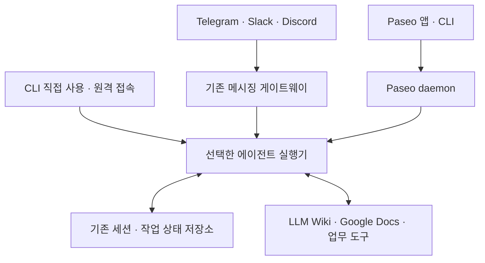

# 백엔드·기기 연속성·비용 설계

[기능 정의](<../최소한의 에이전트 시스템 구축 - 기능 정의.md>)의 F02·F03·F04·F06·F08·F10·F11을 구현할 때 읽는다. 사용자가 말한 “lite SQL”은 SQLite로 해석했다. 아래 구성은 후보이며, 장비·요금제·외부 처리 허용 여부는 [결정 기록](<../30_양식/구축 결정·규칙 기록.md>)에서 확정한다.

능동 운영에는 사용자 요청 없이 시작하는 예약/이벤트 감지, 지속 작업 상태, 실행기 호출과 결과 전달이 필요하다. 기존 도구가 여러 역할을 충족하면 재사용한다. [능동 운영과 완료 추적](<능동 운영과 완료 추적.md>)과 [실행기 독립 운영 검증](<../20_도구별/실행기 독립 운영 검증.md>)으로 담당 호스트·OFF 복귀·실행기 교체를 확인한다. CLI 실행기는 외부 기동과 연결할 수 있지만, 파일 지침이나 원격 접점만으로 상시 관찰 프로세스가 생기지는 않는다.

## 1. 최소 구성의 역할 분리

데이터베이스는 상태·관계·실행 기록을, LLM Wiki는 원문·출처·정리된 지식을 관리한다. **Sheets의 구조화된 표와 Drive의 문서·파일을 연결해 전체 논리 DB로 선택할 수 있다.** SQLite+로컬 파일도 대안이며 SQLite를 반드시 추가하지 않는다. Google Docs는 Drive 안의 공동 편집 본문이 될 수 있고, Jev는 선택적인 판단 모델이다. 기존 DB 구조를 먼저 조사한 뒤 [Sheets·Drive 전체 DB와 로컬 DB 비교](<Google 도구 기반 최소 구성.md>)로 정본·접속·동시성·복구를 선택한다.

| 역할 | 개인의 최소 후보 | 엔터프라이즈 후보·추가 조건 |
| --- | --- | --- |
| 요청 접수·조회 | 기존 CLI·게이트웨이·원격 도구 우선, 부족하면 API 추가 | 기존 인증·API 체계, 사용자/조직별 권한 검사 |
| 에이전트 실행 | 켜져 있는 Mac mini 등 실행기 하나 | 승인된 내부 실행기, 필요 시 여러 작업자와 자원 격리 |
| 작업·승인·중복·재시작 상태 | 기존 내장 기능 또는 Sheets·Drive DB / SQLite·파일 중 선택한 정본; 실행 기록도 필요한 범위 포함 | 허용된 Workspace 또는 내부 DB; 요구 동시성·트랜잭션·가용성을 충족하지 못할 때 서버 DB |
| 기억 | 출처·소유자·교정 상태를 가진 Sheets·Drive, SQLite 또는 기존 런타임 저장소 | 개인/팀/조직 범위, 권한 변경·삭제 전파 |
| 문서 지식·절차 | Markdown 기반 LLM Wiki와 작업별 스킬 | 버전·검토·자료 등급을 가진 조직 저장소 |
| 사람이 편집하는 DB·본문·결과 | Sheets 레코드·관계 + Drive 파일/Docs 본문; 기존 ID·표 구조 재사용 | 승인된 Workspace, 파일별 권한·담당·변경/복구 정책 |
| 검색 | 파일 검색·SQL/전문 검색부터 사용 | 자료량·권한 필터·검색 품질에 따라 추가 |
| 판단 최적화 | 확정 조건은 코드, 의미 판단은 기존 모델 분류 프롬프트부터 비교; 필요 시 Jev | 허용 데이터만 전송, 평가·모델 버전·대체 경로 |
| 백업·감사 | 기존 실행기의 상태 백업/내보내기와 문서 사본, 최소 실행 기록 | 복구 목표·감사 보존·변경 방지·독립 접근 권한 |

벡터 DB, 그래프 DB, Redis, 별도 큐, 멀티에이전트는 기본 필수품이 아니다. 첫 업무의 검색 품질·동시성·복구 요구를 기존 기능으로 충족하지 못할 때 추가하고 근거를 남긴다.

## 2. 데이터의 기준 저장소

| 데이터 | 기준 저장소 후보 | 다른 위치에 두는 사본의 규칙 |
| --- | --- | --- |
| 작업 상태·실행 소유권·중복 키 | 선택한 내장 저장소·Sheets DB·SQLite 중 데이터별 정본 한 곳; 필요한 쓰기 직렬화·복구 보장을 검증 | 화면·알림·캐시는 파생 자료; 실행기 고유 세션과 업무 정본의 역할을 구분 |
| 대화의 지속 기억 | 기존 런타임 저장소 또는 선택한 메모리 저장소 한 곳 | 근거·대상 사용자·유효일·삭제 상태를 함께 관리 |
| 직접 작성한 위키·스킬 | 버전 관리하는 Markdown | 배포 사본에 버전 기록, 변경을 승인된 원본에 반영 |
| Google Docs 공동 문서 | 해당 Docs 파일 | 위키에는 문서 ID·버전·수집 시각을 가진 스냅샷과 파생 요약 |
| 에이전트가 만든 산출물 | 작업별로 정한 파일 또는 Docs | 결과 ID·생성/저장/전달 상태를 기준 실행 기록에 연결; 무결성 대조가 필요하면 내용 해시 |
| 검색 색인·임베딩·캐시 | 원문에서 재생성 가능한 파생 저장소 | 권한 변경·삭제·수정 시 무효화, 원문 권한 검사와 함께 사용 |

- 공통
	- Sheets+Drive 정본, SQLite+파일 정본, 혼합 중 선택한다. 혼합은 데이터별 정본과 복제 방향을 기록하며 같은 업무 상태를 두 곳에서 독립 수정하지 않는다. 내장 세션이 있는 실행기를 써도 별도 SQLite 업무 DB가 필수가 되는 것은 아니다.
	- 같은 문서를 Docs와 Markdown에서 동시에 원본으로 취급하지 않는다. 기본안은 문서마다 원본 하나를 정하고 나머지는 읽기용 스냅샷·요약으로 두는 것이다.
	- 양방향 편집이 필요하면 충돌 판정 버전, 병합 담당, 삭제·이름 변경·이동 처리, 실패 재시도와 변경 이력을 별도 구현한다.
	- 작업 DB·Wiki·Docs의 저장이 하나의 트랜잭션으로 끝난다고 가정하지 않는다. 외부 결과 ID를 기록하고 미완료 단계를 재조정한다.
- 개인 시스템
	- 집과 노트북 사이에 실행 중인 SQLite 파일을 Drive·OneDrive·Obsidian Sync로 동기화해 공동 DB처럼 열지 않는다. API로 한 DB에 접근하고, 백업은 SQLite 백업 API 등으로 만든 일관된 사본을 전송한다.
	- Markdown 파일 동기화는 문서 이동 수단이다. 작업 소유권·예약 실행·자격증명 동기화를 대신하지 않는다.
- 엔터프라이즈 시스템
	- 데이터 영역별 기준 저장소·처리 지역·관리자·보존·삭제 전파를 정한다. 조직별 격리는 SQL 쿼리·서비스 권한·테스트로 집행한다.
	- 삭제·권한 회수를 원문, 기억, 검색 색인, 캐시, 결과 공유에 전파한다. 백업은 보존 정책과 복원 시 삭제 재적용 절차를 따른다.

SQLite를 선택하는 경우, 동시 읽기를 지원하지만 DB별 쓰기는 한 번에 하나다. WAL 방식은 같은 호스트를 전제로 한다. 여러 실행 호스트가 DB 파일을 직접 공유하게 만들지 않는다. 다수의 동시 쓰기·복제·고가용성이 실제 요구가 되면 서버 DB를 선택한다. [SQLite 적용 범위](https://sqlite.org/whentouse.html), [WAL](https://sqlite.org/wal.html), [온라인 백업](https://sqlite.org/backup.html)

## 3. 접점은 선택하고, 서버 가동 여부로 가능한 일을 구분

사용자는 메신저·Paseo·CLI·Slack·Discord·Telegram만으로 작업할 수 있다. 별도 웹앱과 자체 작업 API를 새로 만드는 것은 필수가 아니다. 선택한 제품이 이미 제공하는 접점·세션 저장·재개·백그라운드 실행을 먼저 사용하고, 첫 업무에 부족한 기능만 추가한다.

여기서 서버는 **그 작업을 실제로 실행하는 집 PC/Mac mini, 외부 가상 PC, 중앙 PC 등의 호스트**다. 특정 집 장비로 고정하지 않는다. 서버 전원·실행기/게이트웨이 프로세스·필요한 네트워크·도구 연결이 정상이고 권한이 허용될 때, 선택해 구성한 기능을 사용할 수 있다.

### 3-0. 서버 켜짐·꺼짐에 따른 기능표

2026-10-28 사용자의 방향: “집이나 외부가상 PC, 중앙 PC의 서버가 켜져있을 때 모든 기능 사용 가능한 점과, 꺼져 있을 때 가능한 작업 구분”. 초기안은 자동 장애 전환이나 복잡한 오프라인 처리 없이, 실행 불가능한 작업을 명확히 표시하는 것이다.

| 작업 | 담당 서버·실행기·연결이 정상 | 담당 서버가 꺼졌거나 실행기에 연결 불가 |
| --- | --- | --- |
| 새 요청의 에이전트 처리 | 선택한 접점으로 접수·실행·결과 확인 | 해당 서버의 에이전트 실행 불가 |
| 후속 질문·추가 지시·승인 | 같은 세션/작업으로 전달하고 상태 확인 | 초안 작성 또는 메신저 전송은 가능할 수 있으나 실행·승인 반영 확인 불가 |
| 진행 상태·현재 결과 조회 | 실행기 또는 저장소의 최신 상태 조회 | 실행기 현재 상태는 확인 불가. 기기 기록·메신저 기존 답변, 별도 저장소가 가동 중이면 그곳의 접수·저장 상태를 확인; 마지막 갱신 시각 표시 |
| 이전 파일·산출물 열기 | 서버 파일·허용된 외부 문서 조회 | 기기에 내려받은 사본·접속 가능한 Google Docs 등만 가능; 서버 전용 파일은 불가 |
| Google Sheets DB·Docs·Drive 직접 사용 | 사용자 권한으로 조회·허용 편집 가능 | Google 서비스·네트워크·계정이 정상이면 가능; 해당 서버의 에이전트 접수·처리·색인 갱신은 대기 |
| 로컬 Wiki·메모·요청 초안 | 해당 기기에 자료가 있으면 가능 | 해당 기기에 자료가 있으면 가능; 서버와 동기화 완료로 표시하지 않음 |
| 예약·자동 실행·도구 호출 | 정한 시간·조건·권한 안에서 수행 | 담당 서버에 의존한 실행 중단; 누락 예약은 복구 후 정한 방식으로 처리 |
| 취소 | 취소 요청과 실행 중단 확인 | 취소 의사 기록은 가능할 수 있으나 서버의 취소 완료로 표시하지 않음 |
| 다른 기기의 독립 에이전트 | 그 기기의 환경·권한으로 별도 업무 가능 | 그 기기에 모델·도구 연결이 있으면 별도 업무 가능; 중단된 서버 작업의 자동 승계는 아님 |

- 공통
	- 메신저 전송 성공, 봇/작업 서버의 접수 확인, 실제 실행 완료를 구분한다. 서버가 응답하지 않으면 “접수 확인 안 됨”으로 표시하고 임의로 실행 중·완료라고 하지 않는다.
	- 서버 복구 시 마지막 상태·외부 결과를 확인한다. 오래된 요청·승인·누락 예약을 모두 즉시 실행하지 않고, 만료·중복·권한을 검사해 재개/폐기/확인 대상으로 나눈다.
	- 메신저 제공자가 보류한 메시지를 나중에 전달할 수 있으므로, 초기 시스템은 별도 오프라인 대기열을 만들지 않더라도 메시지 시각·유효 기간·중복 키를 검사한다. 서버 정지 기간 전체의 메시지 보관을 보장하지 않는다.
- 개인 시스템
	- 집 서버를 끄면 해당 업무를 쉬게 두는 구성이 허용된다. 상시 실행이 필요할 때만 외부 가상 PC 등으로 담당 실행 환경을 옮긴다.
	- 집 PC가 꺼져도 실제 담당 서버가 외부 가상 PC에 있고 필요한 데이터·도구가 준비되어 있다면 그 업무는 계속 가능하다. 다른 PC가 켜져 있다는 사실만으로 기존 작업이 인계되지는 않는다.
- 엔터프라이즈 시스템
	- 중앙 서버의 가동 여부와 사용자의 사내/사외 접속 허용을 별도로 판단한다. 서버가 정상이어도 기기·자료·행동 정책에 따라 기능이 제한될 수 있다.
	- 높은 가용성이 실제 업무 요구일 때만 대체 서버·DB 복제·자동 인계를 추가하고 운영 비용과 책임을 정한다.

### 3-1. 기존 접점으로 시작하는 후보

위 분기는 대안이며 모두 설치하라는 뜻이 아니다. 게이트웨이와 실행기는 같은 제품·프로세스일 수 있다. 제품 간 세션 저장소를 직접 공유하거나 파일을 합치라는 의미도 아니다.

| 접점 | 어떻게 작업하는가 | 먼저 확인할 것 |
| --- | --- | --- |
| Telegram·Slack·Discord | 기존 봇/게이트웨이가 메시지를 받아 실행기에 전달하고 같은 대화·스레드에 응답 | 사용자·대화방 허용, 세션 범위·초기화·재개·첨부·승인 지원 |
| Paseo | 호스트 daemon이 실행하는 에이전트를 모바일·데스크톱·CLI 등에서 제어 | 지원 제공자·인증·페어링·서버 상태·접속 경로 |
| CLI | 담당 호스트에서 직접 실행하거나 승인된 원격 연결로 동일 호스트/세션에 접근 | 세션 재개, 터미널 연결 종료 후 실행 지속, 작업 폴더·권한 |
| 자체 웹 화면 | 기존 접점으로 충족되지 않는 업무 목록·양식·대시보드가 필요할 때 개발 | 추가 개발·인증·유지 비용과 실제 필요성 |
| 기타 메신저 | 공식 연결 기능 또는 검증한 어댑터로 연결 | 모든 메신저가 같은 봇 API·기능을 제공한다고 가정하지 않음 |

**최소 후보:** 메신저 업무라면 기존 게이트웨이와 메신저 하나, 코딩 에이전트의 원격 조작이라면 Paseo 등의 기존 도구를 먼저 검토한다. 모든 채널 동시 도입이나 별도 웹앱은 시작 조건이 아니다.

### 3-2. 기기 전환과 채널·에이전트 전환을 구분

| 전환 | 연속성을 확보하는 방법 |
| --- | --- |
| PC Telegram→휴대폰 Telegram의 같은 대화 | 같은 봇·사용자·채팅/스레드가 기존 세션으로 연결되는지 확인. 기기마다 새 세션을 만들 필요 없음 |
| Paseo 데스크톱→Paseo 모바일/CLI | 같은 daemon과 관리 중인 에이전트를 선택. 연결이 끊겨도 호스트가 정상이라면 실행 상태를 다시 조회 |
| CLI→메신저 | 제품의 공식 handoff/resume 기능이 있으면 사용. 없을 때만 별도 세션 연결·맥락 전달 기능 추가 |
| Telegram→Slack/Discord | 기본적으로 플랫폼·대화방·스레드가 다르므로 세션 범위를 확인. 명시적 인계·선택 없이 자동으로 모든 대화를 합치지 않음 |
| 서로 다른 에이전트·호스트 | 이전 실행 소유권·외부 결과를 확인하고 결정·근거·결과·다음 행동을 인계. 세션 파일의 자동 호환을 전제하지 않음 |

기억·Wiki를 함께 쓴다고 현재 대화와 실행 중 작업이 자동으로 하나가 되는 것은 아니다. 각 접점의 `(플랫폼, 계정/조직, 사용자, 채팅/스레드)`와 런타임의 세션/작업을 어떻게 연결하는지 기록한다. 같은 표시 이름만으로 사람을 동일시하지 않으며 개인 DM의 내용을 조직 공개 채널로 자동 전달하지 않는다.

### 3-3. 확인한 기존 제품 기능 — 2026-10-28

- **Hermes**
	- 공식 Messaging Gateway는 Telegram·Slack·Discord 등을 백그라운드 프로세스로 연결한다. 세션 저장 기능이 있어 메신저 사용을 위해 자체 웹앱·별도 세션 DB부터 만들 필요는 없다. [Gateway](https://hermes-agent.nousresearch.com/docs/user-guide/messaging)
	- 공식 Sessions 문서는 내장 SQLite 상태 저장과 플랫폼·대화/스레드별 세션 구분을 설명한다. 같은 계정·대화를 다른 기기에서 여는 경우 같은 세션으로 연결될 수 있는 구조이며, 이는 세션 키에 기기 ID가 없다는 점에 근거한 해석이다. 실제 환경에서 확인한다.
	- CLI의 `/handoff telegram` 등으로 세션을 메신저에 인계할 수 있다. 동일 호스트/프로필의 Gateway 가동, 대상 플랫폼 연결, 목적지 채팅의 `/sethome` 설정이 필요하며 실행 중인 턴이 끝나야 한다. Telegram은 목적지의 topic 지원·설정도 확인한다. CLI 복귀에는 `hermes -r "세션 제목"` 등 공식 재개 기능을 사용한다. 제품·설치 버전에 맞춰 적용한다. [Sessions](https://hermes-agent.nousresearch.com/docs/user-guide/sessions), [명령 참조](https://hermes-agent.nousresearch.com/docs/reference/slash-commands)
- **Paseo**
	- 호스트 daemon에서 코딩 에이전트를 실행하고 모바일·데스크톱·웹·CLI 클라이언트가 연결한다. Claude Code·Codex 등 지원 제공자의 실제 CLI·인증은 호스트에 준비한다. 웹은 선택 접점이다. [시작 안내](https://paseo.sh/docs), [제공자](https://paseo.sh/docs/supported-providers)
	- 페어링 후 relay 또는 지원되는 사설/원격 연결을 사용한다. 호스트·daemon은 실행 중이어야 한다. 따라서 Cloudflare를 추가해야만 원격 접속이 가능한 것은 아니다. [연결 방식](https://paseo.sh/docs/connectivity)
	- 공식 변경 기록은 외부 터미널에서 시작한 Claude·Codex·OpenCode 세션 가져오기를 안내한다. 다만 실행 중인 임의 프로세스를 무중단으로 붙잡거나 두 곳에서 동시에 제어할 수 있다는 보장은 이 확인에 포함하지 않는다. [변경 기록](https://paseo.sh/changelog)
	- 별도 Paseo Hub는 Slack·Discord 트리거와 같은 스레드에서 기존 에이전트를 계속 사용하는 기능을 제공한다. 필요할 때만 추가하고 권한·지원 제공자·플랜·비용을 확인한다. [Hub 트리거](https://paseo.sh/docs/hub/triggers)

이 내용은 공식 문서 확인이며 설치·연결·세션 이동 시험 결과가 아니다. 세션용 내장 저장소가 업무별 중복 방지·외부 결과 복구·감사 요구까지 충족하는지는 별도로 확인한다. 부족한 업무 상태만 확장한다.

### 3-4. Cloudflare와 자체 API도 선택 요소

- Telegram의 `getUpdates` long polling, Slack Socket Mode, Discord Gateway는 담당 서버가 제공자와 통신하는 연결 방식이다. 이런 방식을 선택하면 메시지를 받기 위해 별도 공개 웹앱·공개 수신 주소·Cloudflare Tunnel을 반드시 만들 필요는 없다. 외부로 나가는 통신은 필요하다. [Telegram](https://core.telegram.org/bots/api#getupdates), [Slack](https://docs.slack.dev/apis/events-api/using-socket-mode/), [Discord](https://docs.discord.com/developers/events/gateway)
- 웹훅 수신·자체 웹 화면·특정 사내 접근 경로가 필요할 때 그 경로를 추가한다. Telegram long polling과 webhook은 동시에 사용하는 방식이 아니다. Telegram Bot API의 미수신 업데이트 보관은 최대 24시간이므로 서버 중단 중 무기한 접수가 보장되지 않는다.
- 자체 HTTP API가 필요하면 `작업 생성 / 허용 작업 조회 / 진행 사건 / 추가 메시지 / 승인 / 취소 / 결과 조회`를 구현한다. 기존 daemon·SDK·게이트웨이 API가 충족하면 이를 재사용한다. 자체 `/api/tasks` 경로나 UUID 체계를 새로 만드는 것은 의무가 아니다.
- HTTP 웹 방식을 선택한 경우에만 공통 URL·로그인·인증된 다운로드를 구성한다. Cloudflare Access 사용 시 원본의 JWT 검증과 앱 내부 권한 검사도 필요하다. [공개 앱 보호](https://developers.cloudflare.com/cloudflare-one/access-controls/applications/http-apps/self-hosted-public-app/)
- 어느 접점에서도 접수·추가 요청을 먼저 영속 저장하고 실행한다. 오래된 답변·승인·중복 메시지를 검사하며 요청 연결 종료와 작업 취소를 구분한다. 이 기능을 제품이 제공하면 다시 구현하지 않는다.

### 3-5. 최소 구축·검증 순서

1. 첫 접점 하나와 담당 서버·실행기를 선택한다. 기존 세션 저장·재개·백그라운드 실행이 요구사항을 충족하는지 확인한다.
2. 허용 사용자·채팅/스레드·작업 폴더·도구 권한을 정하고 해당 접점에서 대표 업무를 수행한다. 문서/API에 이름만 있다는 이유로 연결 완료라고 하지 않는다.
3. 같은 접점의 PC→휴대폰 전환을 시험한다. 진행 조회·추가 지시·결과 열기가 같은 작업에 반영되는지 확인한다. 추가 지시는 실행기 지원에 따라 즉시 또는 다음 단계에서 반영한다.
4. 필요한 경우에만 CLI↔메신저·Paseo 또는 채널 간 공식 인계 기능을 시험한다. 세션 ID·담당·내용·권한이 어떻게 유지되는지 기록한다.
5. 담당 서버를 중지하고 3-0표대로 실행 불가·접수 미확인·기존 결과·문서 직접 편집을 구분할 수 있는지 확인한다. 새 웹 대시보드가 아니라 사용 중인 접점에서 확인할 수 있으면 충분하다.
6. 서버를 다시 켜서 마지막 상태·외부 결과·누락 예약·오래된 메시지를 대조한다. 중복 실행·만료 승인·개인/조직 대화 누출을 막고 미완료 항목만 재개한다.

현재는 설계와 시험 계획이다. 기존 도구로 가능한 범위와 추가 구현이 필요한 범위를 구분하고, 실제 채택한 접점·서버의 증거가 있을 때 연속성 검증 완료로 기록한다.

### 3-6. 여러 에이전트의 협업 — Reason Network는 선택 요소

2026-10-28 공식 안내상 Reason Network 연결 기능은 무료이며, 모델 사용과 클라우드 Reason 세션의 실행 비용은 별도다. 기존 하네스의 세션을 발견하고 메시지·업무 요청을 전달하는 역할이다. 대화·메모리·파일·권한·작업 상태가 자동으로 하나가 되는 구조는 아니다. [비용·적용 근거와 설정 확인 사항](<../90_참고자료/Reason Network 비용·적용 검토.md>)

- 공통
	- 사람의 접점은 메신저·Paseo·CLI, 실행은 각 에이전트, 에이전트 간 요청은 필요할 때 Reason Network가 맡는다. 첫 업무를 한 에이전트로 처리할 수 있으면 이 계층은 생략한다.
	- 별도 중앙 서버를 새로 만드는 것은 필수가 아니다. 작업을 수행할 각 컴퓨터의 daemon·에이전트·연결이 살아 있어야 하며, 수신·대기·실행·완료를 구분한다. 꺼진 기기의 작업·로컬 자료를 다른 기기가 자동으로 이어받는 것은 아니다.
	- 설치 전후의 기존 MCP·hooks·권한 설정 변경을 확인하고 참여 폴더·수신 정책을 정한다. 네트워크 수신 승인이 개별 파일 접근·외부 발송·비용 사용의 권한을 대신하지 않는다.
- 개인 시스템
	- 기존 컴퓨터 두 대와 시험용 세션 2–3개로 발견·요청·응답·기기 중지/재개를 확인한 뒤 필요한 범위만 넓히는 안을 우선한다. Reason CLI의 무료 연결을 사용하되 실제 모델 구독/API·전기 비용은 D06에 포함한다.
- 엔터프라이즈 시스템
	- 구성원·기기·프로젝트 경계, 초대·회수, 외부 연결 경로와 메타데이터 반출, 감사 보존을 D04에 기록한다. 동료 에이전트의 요청이 사용자나 조직 관리자의 권한을 자동 상속하지 않도록 한다.
	- 필요하면 오픈소스 엔진·자체 relay를 검토하되, 소프트웨어 무료와 내부 운영비·보안 요구 충족을 구분한다. 선택한 구성에서 실제 강제되는 정책을 확인한다.

도입 결정·설치·연결 시험은 아직 수행하지 않았다. 여러 에이전트를 연결할 때만 D03·D04·D06과 연결 계약을 구체화한다.

## 4. 이어받기에 필요한 정보와 조건부 확장

단일 실행기에서는 기존 세션 ID·대화·진행/대기 상태·결과·재개 기능을 먼저 사용한다. 아래 표는 필요한 역할을 점검하는 목록이며 모든 필드를 담는 새 DB·자체 API를 만들라는 뜻이 아니다. 외부 변경을 하는 업무에는 중복·결과 확인을, 다중 작업자·자동 인계를 선택한 경우에는 소유권 제어를 추가한다. 실제 API·DB는 아직 생성하지 않았다.

| 점검 항목 | 기존 기능 또는 필요한 경우 추가할 정보 |
| --- | --- |
| 작업 | 기존 세션/작업 ID, 사용자/조직, 목표·상태·시각; 중복 요청·동시 변경이 있는 경우 요청 키·상태 버전 |
| 맥락 | 확인된 결정, 짧은 작업 요약, 근거 ID·버전·접근 범위, 산출물 ID, 남은 질문·다음 행동 |
| 실행 단계 | 단계 ID, 시도 횟수, 입력 해시, 시작·종료·오류, 외부 결과 ID, 다음 재개 지점 |
| 소유권 | 담당 실행기·취소 상태; 다중 작업자·자동 인계가 필요한 경우 임대·heartbeat·세대 번호 또는 동등한 제품 기능 |
| 승인 대상 | 요청자·승인자, 허용 행동·대상·내용 해시·유효 기간, 적용 정책 버전 |
| 문서 연결 | 공급자·파일 ID, 원본 버전, 수집 커서·시각, 내용 해시, 파생 자료 위치·삭제 상태 |
| 운영 기록 | 요청·작업·사용자·실행 주체 연결, 허용/거부·정책 사유, 비용·지연·결과 참조 |

1. 중복 전송이 가능한 접점은 기존 중복 방지 기능을 확인한다. 직접 접수 저장소를 구현한다면 `(사용자/조직 범위, 요청 키)` 유일성 등으로 같은 요청은 기존 작업을 반환하고 같은 키의 다른 내용은 충돌 처리한다. 기존 제품에 별도 DB를 덧붙이는 것이 목적은 아니다.
2. 상태는 `queued → running → waiting_input / waiting_approval / retry_wait → succeeded / failed / cancelled`로 구분하고 전이 조건을 정한다. `waiting_*`의 담당·만료·재개 조건도 저장한다.
3. 단일 실행기는 재시작 시 기존 미완료 상태·실제 결과를 대조한다. 여러 작업자나 자동 인계를 선택한 경우에만 임대·원자적 점유·세대 번호 등 소유권 제어를 구현하거나 제품 내장 기능으로 충족한다.
4. 외부 변경은 호출 전에 실행 의도와 중복 키를 기존 제품의 영속 실행 기록·저장소에 남기고 재시도에서도 동일 키를 사용한다. 이 기능을 직접 구현할 때 DB 등을 사용한다. 단계별 중복 키·결과 ID로 실제 결과를 확인한다. 임대 만료만으로 외부 발송이 취소되지는 않는다. 결과가 불명확하면 먼저 조회하고 확인 불가 시 사람에게 인계한다. 외부 서비스까지 무조건 정확히 한 번 실행된다고 약속하지 않는다.
5. 선택한 접점의 생성·조회·답변·승인·취소·결과 기능을 허용 범위에서 사용한다. 동시 변경·오래된 승인이 가능한 업무는 제품의 충돌·승인 대조 기능을 확인하고, 직접 API를 만들 때 예상 버전·이벤트 커서 등으로 구현한다.
6. 기기나 모델을 바꾸면 사용자 목표·확정 결정·필요 근거·결과·다음 행동으로 맥락을 재구성한다. 모델 내부 추론이나 다른 제품의 세션 파일이 그대로 호환된다고 가정하지 않는다.

### 4-1. 선택 시나리오의 데이터 연결

목표·일정·할 일을 함께 쓰면 목표 맥락·업무 상태·시간 블록·에이전트 실행의 기준 원본과 ID를 구분한다. 기존 노트·할 일 도구·Calendar로 이 역할을 채울 수 있다. [업무 시나리오](<업무 시나리오·셋업 질문.md>)와 [일정·할 일 확인 사항](<../90_참고자료/일정·할 일 도구 확인 사항.md>)으로 필요한 데이터·UI/API 범위를 정하고 새 DB는 부족한 역할에만 추가한다. 여러 시나리오를 공유 호스트에서 운영해도 개인/기업 자료·인증·기억 권한은 구분한다.

대화 전체 보관·전사를 선택하면 원본 파일·전사·교정·요약·후속 업무의 참조와 단계별 상태를 기존 저장소·실행 기록에 연결한다. [대화 가이드](<대화 수집·전사·지식화.md>)에 따라 수집/처리 호스트·보존·외부 전송·전사 및 저장 비용을 정한다. 호스트가 꺼진 동안 독립 서비스의 수집·알림 가능 여부와 해당 에이전트의 처리 불가를 구분한다.

## 5. Google Sheets·Docs·Drive 연결

Sheets는 단순 조회 화면뿐 아니라 구조화된 상태·관계·실행 기록의 기준 DB가 될 수 있다. Drive의 문서·첨부와 파일 ID로 연결한다. [Google 도구 기반 최소 구성](<Google 도구 기반 최소 구성.md>)의 기존 DB 조사 → 정본 선택 → 쓰기·참조·복구 계약 → 조건부 검증을 적용한다. Sheets 배치 쓰기의 원자성을 여러 파일·서비스의 트랜잭션이나 조건부 갱신 보장으로 확대하지 않는다.

- 공통
	- 기존 Codex·Claude·Hermes의 연결 기능이 첫 업무를 충족하면 먼저 재사용한다. 구축 도구에서 연결된 계정이 별도 운영 실행기에서도 자동으로 사용 가능하다고 가정하지 않는다.
	- 사용자 인증·파일 선택·읽기·쓰기·공유 권한을 분리한다. 문서 본문은 Docs API, 파일 탐색·변경 감지·내보내기·공유 등은 필요한 Drive 기능으로 연결 계약을 작성한다.
	- 파일 ID를 기준으로 원본을 식별한다. 폴더·제목·URL만으로 중복 판단하지 않는다. 최신 본문을 읽고 버전 조건으로 수정하며 충돌 시 다시 읽어 비교한다.
	- 변경 커서·내용 해시·실패 재시도를 관리한다. 변경 알림은 재조회 계기로 사용하고, 누락·채널 만료에 대비한 주기적 대조 방법을 둔다. 초기에 저빈도 조회로 충분하면 알림 서버를 추가하지 않는다.
	- 문서의 외부 공유·권한 변경은 본문 편집과 별도 행동이다. 공개 링크를 자동 생성하지 않고 연결 계약의 공유 범위를 적용한다.
- 개인 시스템
	- 선택한 파일만 접근하는 OAuth 범위를 우선 검토한다. 광범위한 Drive 조회가 필요한 경우 실제 필요한 범위와 비용을 기록한다.
	- Google Docs를 모바일 편집·결과 검토 창구로 사용할 수 있다. Docs 댓글이나 문장 자체를 실행 승인으로 사용하려면 작성자·대상·변경 버전을 확인하는 별도 규칙이 필요하다.
- 엔터프라이즈 시스템
	- 조직이 허용한 OAuth 앱·계정·문서 위치·공유 정책을 적용한다. 모든 사내 문서를 한 서비스 계정으로 읽고 결과만 나중에 필터링하는 설계를 피한다.
	- 개인 Google 계정과 조직 Workspace를 구분하고, 사내 원문·임베딩·모델 입력의 외부 전송 허용 여부를 각각 판단한다.

API 요금·할당량·인증 범위·버전 제어에 대한 확인 내용은 [저비용 서비스 확인 사항](<../90_참고자료/저비용 서비스 확인 사항.md>)을 사용한다. 연결·동기화·권한 회수 시험은 아직 미수행이다.

## 6. 무료·최소비용 배포 후보

| 후보 | 구성 | 비용과 제한 | 적합한 경우 |
| --- | --- | --- | --- |
| A. 보유 장비 중심 | 보유 PC + 기존 실행기·내장 상태 + 지정 자료/결과 폴더; 필요 시 Wiki·기존 연결 | 새 서버 임대비를 줄임; 전기·장비·모델·백업·운영 시간은 별도 | 해당 장비에서 시작하거나 장비 중단을 감수할 수 있는 개인 |
| A-G. Sheets·Drive DB 중심 | 기존 실행기 + Sheets 표·관계·진행 상태 + Drive 본문/첨부; 필요 시 로컬 파생 캐시 | 별도 DB 서버 없이 가능; API 한도·저장·계정·모델·백업 비용 확인 | 기존 Google DB를 재사용하거나 여러 기기에서 직접 조회·편집하려는 경우 |
| B. 집 실행기 + Cloudflare 접속 | A에 Tunnel + Access, 필요 시 가벼운 웹 화면 | 무료 범위 가능; 인증 정책·앱 권한 검사·로그 보존 별도 확인 | 밖에서 같은 작업을 이어받는 개인·소규모 |
| C. 가벼운 클라우드 접수·상태 | Pages/Workers + D1, 필요한 파일만 R2; 무거운 실행은 별도 호스트 | 요청·CPU·DB 행 읽기/쓰기·용량·객체 작업·모델 사용량 한도 | 집이 꺼져도 요청 접수·상태 조회가 필요한 경우 |
| D. 조직 내부 운영 | 기존 IdP·보안 접속 + 내부 실행기·DB·문서 저장소 + 감사 체계 | 기존 조직 자원 우선; 검증·로그·복구·보안 운영 비용 포함 | 데이터 반출 제한·조직 운영 책임이 있는 경우 |

- 공통
	- 후보 B의 Tunnel은 연결 경로다. 사용자 인증은 Access 등으로, 실제 자료·행동 권한은 앱과 원본 서비스에서 각각 검사한다. 공개 경로만 만든 상태를 안전한 원격 접속 완료로 표시하지 않는다.
	- 후보 C에서 D1을 작업의 기준 저장소로 선택하면 로컬 SQLite는 캐시·로컬 처리 기록 등 역할을 한정한다. 양쪽을 동등한 작업 DB로 두고 수동 동기화하는 안은 기본안으로 쓰지 않는다.
	- Worker에 CLI 에이전트·브라우저·대용량 로컬 모델을 그대로 올릴 수 있다고 가정하지 않는다. 짧은 API 처리와 장시간 실행을 분리하고 선택한 런타임의 CPU·메모리·지속 실행 한도를 확인한다.
- 개인 시스템
	- 첫 후보는 A에서 기존 메신저·CLI·Paseo 기능을 재사용하는 구성이다. Cloudflare 경로가 필요할 때 B를 선택한다. 모바일 접속 때문에 즉시 DB·벡터 검색·스케줄러를 모두 클라우드로 옮기지 않는다. 기존 서비스로 기능이 충족되면 추가 제품을 생략한다.
	- 기존 실행기의 접수·처리 기능으로 첫 업무를 처리할 수 있으면 별도 DB·큐 서비스를 추가하지 않는다. 클라우드 접수함을 선택할 때만 중복 전달·처리 소유권·재시도 계약을 추가한다.
- 엔터프라이즈 시스템
	- 무료 서비스 사용도 데이터 처리 위치·접근 경로·계약·감사 보존 요구를 충족해야 한다. Cloudflare·Google을 허용하지 않으면 같은 역할을 내부 제품으로 대체한다.
	- 내부망과 외부망의 상세 정책은 [접속 경계와 보안 운영](<접속 경계와 보안 운영.md>)에서 정한다. 원문을 외부 서비스에 보내지 않아도 접속·식별·작업 메타데이터가 외부 처리되는지 확인한다.

### 예산과 유료 전환

`월 총비용 = 기존 구독의 추가 사용료 + 모델 입력·출력·판단 호출 + 서버/전기 + DB·저장·요청 + 도메인·접속 + 로그·백업 + 운영 시간`

- 무료 인프라와 무료 모델 추론을 구분한다. 보유 앱 구독이 별도 API·서버 자동 실행 사용료를 포함하는지는 해당 계약으로 확인한다.
- 업무당 모델 호출 수·평균 토큰·파일 크기·DB 읽기/쓰기·보존 일수와 월 작업 수로 추정한다. 재시도·중복 수집·전체 문서 재색인·빈번한 상태 조회를 포함한다.
- 월 상한·작업당 상한·동시 실행 수·재시도 횟수·알림 임계값·자동 유료 전환 허용 여부를 정한다. 비용 알림은 실제 지출 차단 장치와 다르다.
- 무료 할당량 소진 시 `대기 / 해당 기능 중지 / 낮은 비용 경로 / 승인된 유료 확장` 중 동작을 선택한다. 저장 실패·누락을 성공으로 표시하지 않는다.
- 실험적 판단 모델·벡터 DB·추가 클라우드를 도입할 때는 같은 업무 표본의 성공률·전체 비용·완료 시간·수동 수정량으로 비교한다. 호출 단가만 낮고 전체 처리 비용이 늘면 도입하지 않는다.
- 최신 무료 범위·초과 동작·확인일은 [서비스 확인 자료](<../90_참고자료/저비용 서비스 확인 사항.md>)에 있다. 유료 전환·운영 적용 시 공식 조건을 재확인하고 결정 기록에 남긴다.

## 7. Jev 도입 조건

이 문서의 JEV는 TypeSafe의 Jev를 가리키는 것으로 해석한다. Jev는 상태와 제한된 질문을 받아 선택·점수·확률 등 구조화된 판단을 반환한다. 저장소나 위키·작업 실행기를 대체하지 않는다. [공식 소개](https://docs.typesafe.ai/introduction)

- 공통
	- 첫 구축의 필수 조건으로 두지 않는다. 반복적인 문서 분류·도구 선택·후속 검토 필요 판단이 실제 비용이나 지연의 원인일 때 비교한다.
	- 코드 규칙 → 기존 모델의 [분류 전용 프롬프트](<분류 전용 프롬프트와 검증.md>) → 필요 시 Jev를 같은 표본으로 비교한다. 불확실한 판단은 사람/상위 검토로 보낸다. 기존 모델의 사용 비용·한도는 남으며 무료나 동등 성능으로 전제하지 않는다. 저장할 기억의 후보 선별에는 쓸 수 있지만 최종 출처·교정·삭제 정책은 별도로 유지한다.
	- 임계값·질문·모델 버전·평가 표본·오판 비용·장애 대체 경로를 기록한다. 신뢰도 숫자를 정확성 보장이나 권한 부여로 해석하지 않는다.
- 개인 시스템
	- 작은 업무량에서는 모델·키·전송 경로 하나를 더 운영하는 비용이 절약보다 클 수 있다. 기능을 꺼도 대표 업무가 실행되는 구조로 둔다.
- 엔터프라이즈 시스템
	- 민감 자료 전송·보존·배포 형태를 확인한 후 허용 범위만 사용한다. 인증·권한·반출 허용의 최종 판단은 정책 집행 계층에서 수행한다.

검증된 제품 정보와 미확인 범위는 [SQLite와 Jev 확인 사항](<../90_참고자료/SQLite와 Jev 확인 사항.md>)에 있다.

### Jev·Reason Network의 결정과 인계

두 제품은 선택 요소여도 검토 기록은 생략하지 않는다. [선택 구성 검토·최종 체크리스트](<선택 구성 검토·최종 체크리스트.md>)의 질문으로 도입/미도입/보류·이유·기존 대안을 정하고, 세 양식의 결정→진행→최종 체크리스트·보고서로 연결한다. 보류는 현재 업무 영향·담당·조건·기한을 남긴다.

## 8. 구축 시 확정할 질문

한 번에 아래 전체를 묻지 않고 첫 업무의 의존 순서에 따라 1–3개씩 확인한다. 사용자가 이미 정한 무료·최소비용 방향은 다시 묻지 않는다.

1. D03·D07: 담당 서버는 집 PC·외부 가상 PC·중앙 PC 중 어디인가? 꺼졌을 때 가능한 작업을 구분하는 방향은 재질문하지 않고, 요청 유효 기간·누락 예약 처리·필요한 운영 시간만 구체화한다.
2. D05: 기존 Sheets·Drive DB가 있는가? 구조·ID·연결 파일을 제한된 범위로 확인하고 Sheets·Drive / SQLite·파일 / 혼합의 차이를 설명한다. 작업·기억·위키·본문의 정본, 편집 주체·동기화 방향·복구 목표를 어디에 둘 것인가?
3. D04: 관리된 노트북과 개인 휴대폰에서 허용할 자료·행동은 무엇인가? 회사 자료·메타데이터를 Google·Cloudflare·모델 API로 보낼 수 있는가?
4. D06: 월·작업당 상한과 한도 소진 시 동작은 무엇인가? 무료 범위를 넘으면 멈출지, 어디까지 유료 사용을 허용할지 정한다.
5. D07·D08: 허용 데이터 손실·복구 시간·백업 보관·알림 담당은 누구이며 어떻게 실제 복구를 확인할 것인가?

대표 검증에는 기기 전환·연결 단절·허브 재부팅·동시 답변·권한 회수·문서 충돌·무료 한도 소진·외부 모델 장애를 포함한다. [검증 기록](<../30_양식/검증·운영 기록.md>)에 실제 증거를 남기기 전까지 모두 설계·시험 계획 상태다.
